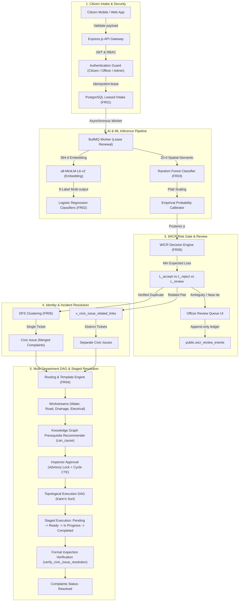

# GrievanceIQ — Academic Project Demonstration Guide & System Manual
**Savitribai Phule Pune University (SPPU) Academic Project 2026–27**  
**Project**: GrievanceIQ — AI-Powered Civic Complaint Intelligence & Resolution Platform  
**System Status**: **STAGING READY** (Fully Verified via Local PostgreSQL/PGlite & Automated Test Suites)

---

## 1. System Architecture Overview

GrievanceIQ is an enterprise-grade civic grievance orchestration platform that transforms unstructured citizen reports into structured, causal-aware, multi-department municipal execution graphs.



---

## 2. Requirement Traceability Matrix (FR01 – FR06)

| Req ID | Capability | Implementation File(s) | Verification Evidence |
| :--- | :--- | :--- | :--- |
| **FR01** | **Complaint Validation & Idempotent Persistence** | `backend/src/workers/complaintWorker.js`<br>`docs/database/phase14_worker_leases.sql` | • `workerLeaseAndIdempotency.test.js`<br>• Distributed lease locking prevents duplicate execution |
| **FR02** | **Dense Embeddings & Multi-Label Triage** | `backend/src/services/embeddingService.js`<br>`backend/ml/inference/grievanceiq_inference.py` | • `mlSupervisor.test.js`<br>• 7/7 Python PyTest unit checks passed |
| **FR03** | **Spatial-Semantic Relationship Inference** | `backend/src/services/relationshipService.js`<br>`backend/ml/calibrate_relationship.py` | • `relationship_corrected.test.js`<br>• Platt scaling on held-out validation pairs |
| **FR04** | **Cross-Issue DAG Dependencies & Staged Resolution** | `backend/src/services/taskDependencyService.js`<br>`backend/src/services/taskExecutionService.js`<br>`docs/database/phase16_cross_issue_dependencies.sql`<br>`docs/database/phase19_prerequisite_recommendations.sql` | • `crossIssueTaskDependency.test.js`<br>• `prerequisiteRecommendation.test.js`<br>• Atomic cycle CTE check + advisory lock |
| **FR05** | **Duplicate-Only Incident Identity** | `backend/src/services/complaintGraphService.js`<br>`backend/src/services/historicalGroupingRepairService.js`<br>`docs/database/phase15_duplicate_only_identity.sql` | • `duplicateOnlyIncidentGrouping.test.js`<br>• `Related` pairs never merge tickets |
| **FR06** | **WICR Decision Service & Review Dashboard** | `backend/src/services/wicrService.js`<br>`backend/src/controllers/wicrController.js`<br>`frontend/src/components/admin/WicrReviewQueue.jsx`<br>`docs/database/phase18_wicr_audit_immutability.sql` | • `wicrDecisionAndCalibration.test.js`<br>• `wicrController.test.js`<br>• Append-only ledger trigger verification |

---

## 3. Step-by-Step Live Demonstration Script

### Demonstration Scenario: Co-Occurring Infrastructure Incident
A burst water main causes severe subsurface erosion on 5th Avenue, resulting in localized flooding and a massive road cave-in (pothole). Two distinct citizens file reports from their phones.

---

### Act 1: Citizen Complaint Intake & AI Triage (FR01, FR02)
1. **Citizen A** submits:
   - Text: `"Severe water main pipe rupture flooding 5th Avenue"`
   - GPS: `(18.5204, 73.8567)`
2. **Citizen B** submits:
   - Text: `"Deep road cave-in and potholes on 5th Avenue near main intersection"`
   - GPS: `(18.5209, 73.8571)`
3. **Automated Backend Pipeline**:
   - Computes 384-dimensional dense semantic embedding via MiniLM.
   - Evaluates 9 multi-label classifiers with per-label decision thresholds.
   - Complaint A classified as **Water Leakage** (Confidence: 94%).
   - Complaint B classified as **Road Damage** (Confidence: 91%).

---

### Act 2: Pairwise Relationship Inference & Platt Calibration (FR03, FR06)
1. The 20-dimensional feature extractor computes spatial distance ($\sim 65$ meters), temporal delta ($< 1$ hour), and semantic embedding similarity ($0.82$).
2. The Random Forest ensemble evaluates the pair and outputs relationship class: **Related** (Raw score: $0.78$).
3. **Platt Scaling Calibration**:
   $$P(\text{Related} \mid x) = \frac{1}{1 + \exp(-(3.9913 \cdot 0.78 - 3.3834))} \approx 0.4329$$
4. **WICR Loss Evaluation**:
   - $L_{\text{accept}} = (1 - 0.4329) \times 10.0 = 5.671$
   - $L_{\text{reject}} = 0.4329 \times 5.0 = 2.165$
   - $L_{\text{review}} = 1.000$
   - Minimum expected loss is $L_{\text{review}} = 1.0$. The pair is automatically routed to the **Officer Review Queue**.

---

### Act 3: Municipal Officer Review Dashboard (FR06)
1. Navigate to `/admin?tab=wicr-reviews`.
2. Inspect the candidate comparison card:
   - Left card: Complaint A (Water Leakage, Water Department).
   - Right card: Complaint B (Road Damage, Road Department).
   - Expected loss breakdown cards ($L_{\text{accept}}$, $L_{\text{reject}}$, $L_{\text{review}}$).
   - Confidence meter highlighting calibrated posterior likelihood.
3. Click **Accept Relationship**.
4. Enter officer notes: `"Approved as related cross-department infrastructure incident."`
5. The decision is committed with row-level locks, updating `complaint_relationships` and appending an immutable audit event to `public.wicr_review_events`.

---

### Act 4: Incident Identity & Grouping Verification (FR05)
1. Navigate to the **Civic Issues** tab.
2. Note that Complaints A and B **remain in separate Civic Issues**:
   - Civic Issue #1: *Water Pipe Rupture* (Complaint A)
   - Civic Issue #2: *Road Surface Damage* (Complaint B)
3. Under the **Related Issues** tab, view the cross-issue link:
   - Confirms that `Related` links preserve operational relationships without corrupting individual incident tracking or responsibility.

---

### Act 5: Department Workstream Routing & Template DAG (FR04)
1. Click **Execute Routing & Tasks** on Civic Issue #1 (Water Leakage):
   - Generates Water Department workstream with tasks:
     - Task 1: `Inspect leakage` (`water_inspect`)
     - Task 2: `Isolate/repair pipeline` (`water_repair`)
     - Task 3: `Verify restoration` (`water_verify`)
2. Click **Execute Routing & Tasks** on Civic Issue #2 (Road Damage):
   - Generates Road Department workstream with tasks:
     - Task 4: `Inspect road damage` (`road_inspect`)
     - Task 5: `Repair road surface` (`road_repair`)

---

### Act 6: Causal Prerequisite Recommendation & DAG Approval (FR04, FR06)
1. Open the **DAG Viewer** tab on Civic Issue #2.
2. Click **Infer Prerequisites**:
   - Engine evaluates `civic_knowledge.json` rule: `Water Leakage can_cause Road Damage`.
   - Recommends: **Task 2 (`water_repair`) must precede Task 5 (`road_repair`)**.
   - Displays 90% confidence score, explainable causal justification, and rule version `1.0`.
3. Click **Accept & Enforce Edge**:
   - Stored procedure `public.accept_dependency_recommendation` verifies cycle reachability via PostgreSQL advisory lock and inserts the edge `task_5 -> task_2` into `public.task_dependencies`.

---

### Act 7: Staged Execution Blocking & Municipal Verification (FR04)
1. Attempt to start Task 5 (`Repair road surface`):
   - System displays a safety error: `🔒 Cannot start task. Prerequisite task "Isolate/repair pipeline" is not COMPLETED or VERIFIED.`
2. Complete Task 1 (`water_inspect`) and Task 2 (`water_repair`):
   - Water Department marks leak isolated and pipe repaired.
3. Return to Civic Issue #2:
   - Task 5 automatically unblocks and transitions to **READY**.
   - Start Task 5 and mark **COMPLETED**.
4. Click **Verify Task**:
   - Municipal field inspector enters physical inspection notes. Task transitions to **VERIFIED** status.

---

### Act 8: Multi-Department Resolution Verification & Complaint Closure (FR04, FR01)
1. In Civic Issue #1, attempt to verify and close while any task is incomplete:
   - Stored procedure `public.verify_civic_issue_resolution` rejects closure: `Cannot verify resolution: incomplete tasks remain.`
2. Complete all remaining tasks across all workstreams.
3. Click **Verify & Close Civic Issue**:
   - Civic Issue transitions to **VERIFIED**.
   - Linked complaints automatically transition to **Resolved**.
   - Citizens receive automated resolution confirmation.

---

## 4. Installation & Local Staging Execution

### Prerequisites
- Node.js $\ge 22.0.0$
- Python $\ge 3.11$
- PostgreSQL 15+ (or automated PGlite embedded test engine)

### Setup Commands
```bash
# 1. Clone repository & install dependencies
git clone <repo-url>
cd grievanceiq

# 2. Backend setup
cd backend
npm install
cp .env.example .env

# 3. Python ML dependencies
pip install -r ml/requirements.txt

# 4. Frontend setup
cd ../frontend
npm install
npm run build

# 5. Run automated verification suites
cd ../backend
npm run test:unit            # 254 unit tests across 26 suites
npm run test:integration     # 11 integration tests in PGlite
pytest ml/tests/             # 7 Python ML tests
```

---

## 5. Known Limitations & Staging Readiness Certification

### Staging Readiness Declaration: **STAGING READY**
- **Verified Capabilities**:
  - Full functional logic (FR01 through FR06) verified via 254 unit tests and 11 embedded PGlite integration tests.
  - Multi-department causal DAG inference, atomic advisory locking, and cycle-prevention CTEs verified.
  - WICR expected loss engine, Platt probability calibration, and append-only audit triggers verified.
  - Production frontend build compiled with zero errors.
- **Production Pre-Deployment Requirements**:
  1. **Live Supabase Cluster**: Requires provisioning dedicated production Supabase project credentials in `.env` (currently configured with development placeholders).
  2. **Live Redis Cluster**: Requires provisioning production Redis instance (e.g. Upstash direct connection) for distributed BullMQ queue workers.
  3. **High-Load Concurrency**: Staging multi-worker stress testing under simulated concurrent node failure must be executed prior to public municipal launch.

